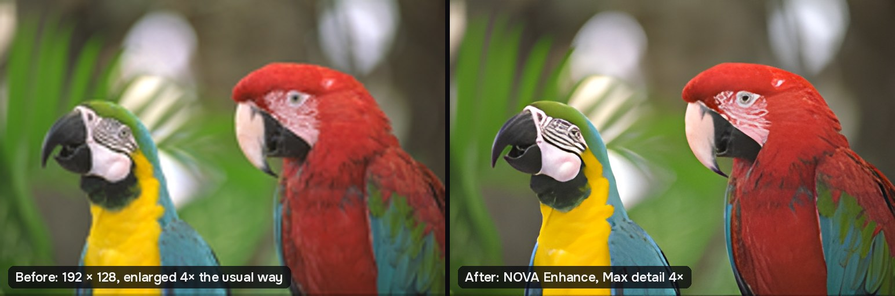
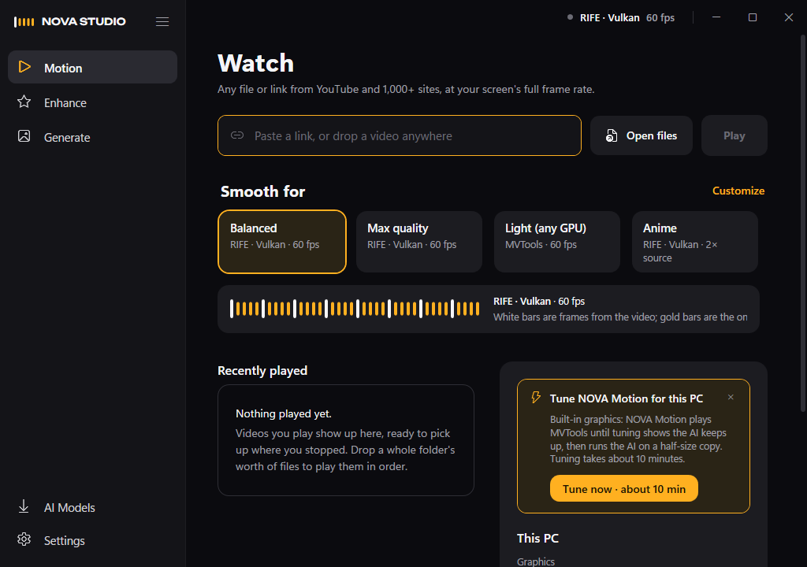
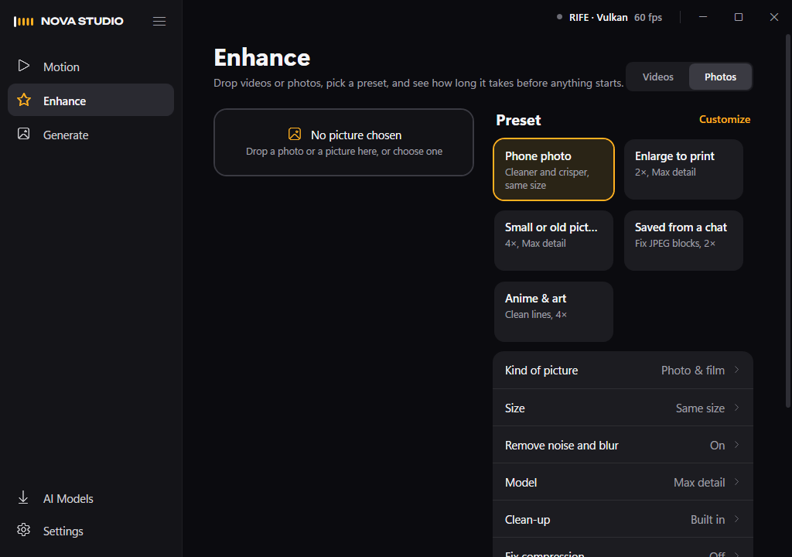
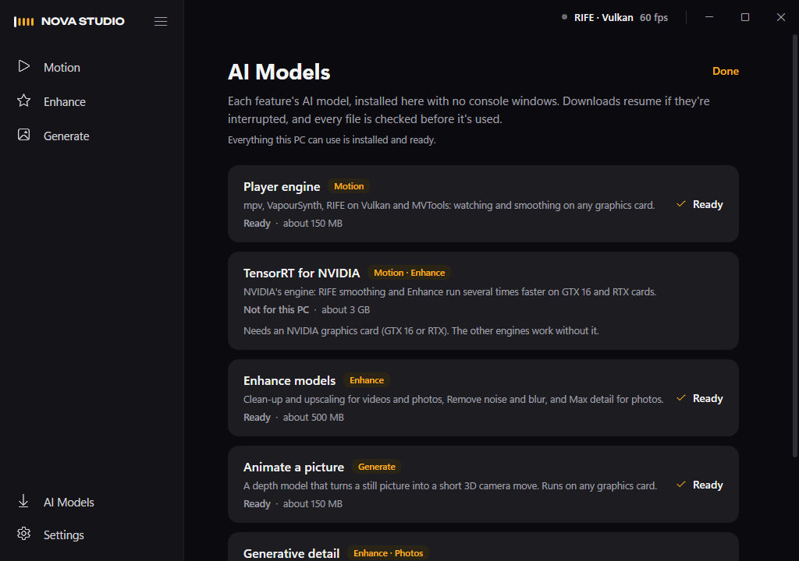
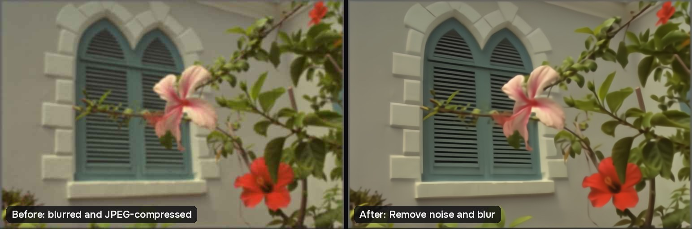
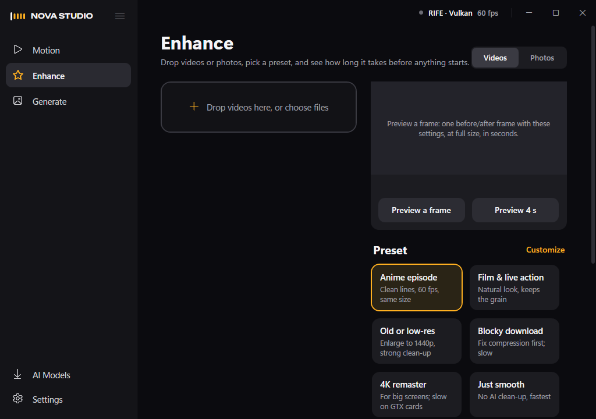

# NOVA Studio

**AI for your videos and photos, on your own PC.** Free, open-source Windows app by Novabit. Smooth any video to your screen's frame rate as it plays, clean up and enlarge videos and photos, add real detail with generative AI, and bring still pictures to life. Nothing is uploaded and nothing is paid per use; it runs even on a GTX 1650 laptop. (The first module was called NOVA Motion, and the repository keeps that name.)

**[Download for Windows](https://github.com/owaiskamal/nova-motion/releases/latest)** · [Website](https://owaiskamal.github.io/nova-motion/) · [How it works](docs/ENGINEERING.md) · [Report a problem](https://github.com/owaiskamal/nova-motion/issues)

A 192 × 128 picture made 4× larger: bicubic, and Max detail (Real-ESRGAN x4plus) at full strength, the model's own output. Photo: Kodak Lossless True Color Image Suite.

<!-- Demo: a 60 fps before/after clip goes here. Upload the MP4 by dragging it into this file in GitHub's web editor; GitHub inserts a link it plays inline. Credit under it: Footage: Tears of Steel (CC BY 3.0) Blender Foundation, mango.blender.org -->

## What's inside

| | What it does | Runs on |
| --- | --- | --- |
| **Motion** | Live AI smoothing (RIFE) to your screen's frame rate, for files, YouTube and 1,000+ sites, in a full player | Any graphics card; fastest on NVIDIA with TensorRT |
| **Enhance videos** | Clean-up and upscaling to 4K or 8K (Real-ESRGAN, Real-CUGAN, DPIR) and 60 fps copies, with a preview and a time estimate first | Any graphics card |
| **Enhance photos** | Max detail (Real-ESRGAN x4plus), Remove noise and blur (NAFNet), and **Generative detail** (SeedVR2), which draws new detail that fits the picture | Any card; Generative needs NVIDIA with 4 GB or more |
| **Generate** | Animate a picture: a still becomes a short 3D camera move (Depth Anything). Images and clips from open models are next | Any graphics card |
| **AI Models** | Every part installs inside the app, with real progress, pause and resume, and a disk-space check | |

| Motion | Enhance photos | AI Models |
| --- | --- | --- |
|  |  |  |

Remove noise and blur at the same size. The photo was blurred and saved as a low-quality JPEG for this test. Photo: Kodak test set.

## Motion

- **Real AI frames, live.** RIFE, an open AI model, makes the in-between frames while you watch. The frames from the video itself are never touched.
- **Fits your graphics card.** A one-time tuning run measures each model on your PC and the engine uses the best one that keeps up. On cards like a GTX 1650 the AI works on a half-size copy and only its frames are scaled up, and 4K video is smoothed at 1080p (online video is fetched at 1080p at most while smoothing), which looks the same on a 1080p laptop screen at a quarter of the work.
- **YouTube and 1,000+ sites.** Paste a link, or send the video you're watching from Chrome or Edge with the browser extension. It picks up where you stopped.
- **Smooth from the first second.** A video size the AI hasn't seen before plays right away, with a fitting engine or MVTools, while the AI engine for it is prepared in the background; NOVA Motion switches over by itself when it's ready.
- **You always see what it's preparing.** Getting an AI model or engine ready for your graphics card takes minutes the first time on GTX-class cards; **Activity**, in the sidebar, shows which one, the step and the time left, along with every export, on every page.
- **A player like the best ones.** Seek previews (a picture of the moment under the mouse), chapters with **Skip intro** and **Skip recap**, ±10 s and double-click the sides to jump, hold → for 2×, an **Up next** countdown, **picture in picture**, subtitle and audio timing, subtitle size, **night mode** (quieter explosions, clearer voices), volume up to 150 %, brightness, contrast, saturation and gamma, aspect, fit/fill/stretch and rotation, an A–B loop, a sleep timer, and a shortcuts sheet (? or F1).
- **Steady, never stuck.** If frames start dropping it switches to a lighter setting on its own instead of stuttering; **Play without smoothing** is always one click away.
- **Enhance, with presets.** Pick a preset (Anime episode, Film & live action, Old or low-res, Blocky download, 4K remaster, Just smooth; for photos Phone photo, Enlarge to print, Small or old picture, Saved from a chat, Anime & art) and see **how long it will take on your PC before anything starts**. Every option is one tap away in Customize; save your own presets, which also show in the sidebar. AI cleans and enlarges every frame up to 8K (Real-ESRGAN for film and live action, Real-CUGAN for anime and art) and RIFE makes it 60 fps. Preview a frame or 4 seconds as a before/after first. The estimates learn your PC's real speed from every export.
- **iOS-style design.** A sidebar (collapse it to icons only with the button at its top or Ctrl+B; it's remembered), large titles, grouped lists, segmented controls and switches, one amber accent.
- **Animate a picture.** On the Generate page, a still picture becomes a short 3D camera move (push in, drift, sway, orbit…): AI works out what is near and far, and near things move more. Made for illustration, anime and art deco posters with gentle motion, and it runs on any graphics card, a GTX 1650 or Intel laptop graphics included.
- **Free and open.** GPL-3.0. No account, no watermark, no upload: everything runs on your PC.

## What runs on your PC

| Graphics | How NOVA Motion runs |
| --- | --- |
| NVIDIA RTX | RIFE on TensorRT, the fastest path, at your screen's refresh rate |
| NVIDIA GTX 16 (e.g. GTX 1650) | RIFE on TensorRT with the AI at half size, at 60 fps or an even rate for your screen |
| Other NVIDIA, AMD, Intel | RIFE on Vulkan when tuning shows it keeps up, MVTools otherwise. Supported, tested less so far |

Windows 10 or 11. TensorRT needs a one-time download of about 3 GB, offered during setup on cards that support it.

## Get started

**Installer:** download `NovaMotion-Setup` from the [latest release](https://github.com/owaiskamal/nova-motion/releases/latest), run it (no admin rights needed) and start NOVA Studio. Then open **AI Models** in the sidebar to download the parts you want (TensorRT for NVIDIA, the Enhance models, Animate a picture, Generative detail), with progress inside the app. Windows may show a SmartScreen warning because the installer isn't code-signed yet: choose *More info*, then *Run anyway*.

**From source:** run **`build.cmd`**. It sets everything up and says what it's doing, and you can run it again any time to repair or update; finished steps are skipped:

1. the .NET 8 SDK (offers to install it with winget),
2. the player runtime: mpv, VapourSynth, RIFE on Vulkan with four models, MVTools, yt-dlp (about 150 MB),
3. on NVIDIA RTX and GTX 16 cards, NVIDIA TensorRT through [vs-mlrt](https://github.com/AmusementClub/vs-mlrt) with RIFE 4.6, 4.22 Lite, 4.25 Lite and 4.26 (asks first),
4. the tests, then the app in `dist\`,
5. AI enhance for Enhance: the upscaling and clean-up models (about 500 MB, asks first), and Animate a picture for Generate: a depth model and three Python packages (about 150 MB, asks first),
6. tuning for your PC, redone when it's outdated or the graphics changed,
7. Start menu and desktop shortcuts, and a summary of what's ready.

Options: `build.cmd -Yes` answers every question with yes; `-NoTensorRT`, `-NoEnhance`, `-NoStudio`, `-NoTune` and `-NoShortcuts` skip those steps; `-CheckOnly` only reports what's set up.

**Browser extension (optional):** load `extension\` in Chrome or Edge (`chrome://extensions`, Developer mode, Load unpacked). Alt+Shift+F on any video page sends it to NOVA Motion at the same moment.

## Using it

- **Home:** paste a link or drop files. Recently played videos resume a few seconds before where you stopped, and opening an episode queues the rest of its folder.
- **Live enhance** (Motion panel): *Crisp* and *Extra crisp* sharpen film and video adaptively, without halos and with almost no GPU cost; *Anime* runs Anime4K, which restores line art and enlarges anime to your screen. They run on any graphics card, after smoothing, and switch without restarting the video.
- **On the video:** controls that hide while you watch, a seek bar with buffered range, chapters and hover time, double-click for full screen, scroll for volume.
- **Motion panel** (Tab): the frame rate on screen, dropped frames, the model in use and the size the AI runs at, the cadence strip (white bars are frames from the video, amber ones are generated), and every smoothing choice: engine, frame rate, AI model (Auto or a fixed one) and AI size (Auto, Full, 75 %, Half).
- **Before/after** (Ctrl+D): side by side or a split screen, labelled, to see what the engine adds.
- **Enhance:** a smooth copy of any file at 60 fps, 120 fps or 2× with the best model installed. **AI enhance** adds clean-up and upscaling: *Film & live action* or *Anime & art*, a size (Original, 1080p, 1440p, 4K, 8K), clean-up (keep grain, light, strong), AI strength (how much of the AI's picture is mixed with the original: *Balanced* by default, which stays sharp without the painted look AI can give real footage), extra sharpening and grain, and *Fix compression* for heavily compressed downloads up to 1440p. Upscaling comes after RIFE, so real and generated frames are equally sharp. **Preview a frame** shows one full-size before/after frame on the page in seconds (exactly the frame at *From*, in any video), so the look can be tuned before exporting; **Preview 4 s** makes a full-size before/after clip from the time in *From* and plays it. Both previews clean and enlarge only the part of the picture they show (with a margin, so it comes out exactly as in a full export): about an eighth of the AI work, so a 4 s preview at 4K takes minutes instead of tens of minutes on a GTX 1650. The models are added once with `setup-enhance.cmd` (about 150 MB; build.cmd asks), which also prepares every model for your graphics card, once (on GTX 16 cards about 3–6 minutes a model and 10–20 for the Real-CUGAN anime models; *Prepare all models* on the Enhance page does it again). The progress bar learns how long builds take on your PC and keeps moving, with minutes so far, when one runs long. Only one model is prepared at a time on the PC (a preview, an export, setup and the player's background builds take turns, and none repeats one another just made), and the bar appears only while a model is really being prepared, not when a ready one loads. Files queue up and show time left. **Compare**, under the previews, sets how previews and before/after videos show the picture: **Split** (the default: the whole frame at its finished size, the original on the left and NOVA on the right, so only half is enhanced for a preview), **Side by side** (both whole frames, kept within 3840 px wide: two 1080p frames, as wide as the GPU encoders and sharing sites take; fixed: a 4K side by side was 7678 px wide and the export stopped with "Encoder trying to write packet before muxer was initialized") or **100% detail** (the middle at full size, which used to be the only view and looked zoomed in). Turn on **Before/after video** and give a start time and length to export a short labelled clip to share. *Anime & art* uses Real-CUGAN at every size, enlarging its 2× result the rest of the way, and the *Anime episode* preset adds fine grain (settings already on it get it once). (Fixed: a 480p episode taken to 4K went through AnimeVideo v3, which flattened shading and hatching into a waxy look; Real-CUGAN keeps the line art and cel texture.) (Fixed: grain did nothing on PCs without TensorRT, because it was made by the akarin plugin that comes with it; it's now made with numpy there, and on photos it goes on R, G and B alike instead of tinting red.)
- **Enhance a photo:** on the Enhance page, drop or choose a photo or a piece of art: *Photo & film* or *Anime & art*, same size, 2× or 4× (up to 8K on the long side), clean-up and *Fix compression* for JPEGs saved from chats and websites. **Remove noise and blur** (on in the photo presets but Anime & art) runs NAFNet, trained on blurred and compressed pictures, at the photo's own size before any enlarging: it takes out phone-sensor grain, softness and JPEG damage, and sharpens eyes, lashes and edges. Three quarters of its picture is kept so skin keeps some texture. (Fixed: on GTX cards it turned photos into a green checkerboard, because NAFNet's normalisation overflowed in the half precision TensorRT runs it in; the model in enhance-models-v3 was re-made with the same maths rearranged to stay in range, and a result that's nothing like the photo is now redone without it.) At the same size it *is* the result: a 4× upscaler on a full-size photo, shrunk back 4×, averaged away nearly everything it added, which is why same-size photos used to come out looking unchanged. **Max detail** uses Real-ESRGAN x4plus (and its anime version), the heavy models that add far more texture than the video ones, which a single picture can afford. The model sees the whole picture, transparency is kept, JPEG photos stay JPEG (the rest PNG), and the result comes with a before/after of one part at 100%, side by side (shrunk to fit a screen, a whole photo hides what enhancing changed): click the picture to compare another part. Photos up to 12 MP reach the model whole, at full resolution. It's enhanced in strips (each with picture around it, so they join exactly), and a progress bar shows how far it is and the time left. Saved in Pictures\NOVA Studio. `setup-enhance.cmd` adds what it needs (numpy and Pillow).
- **AI Models page:** every part NOVA Studio can install, in one place (sidebar → AI Models, with a count of what's left): the player engine, TensorRT for NVIDIA, the Enhance models, Animate a picture and Generative detail. Each card says what it unlocks, its size and its state (not installed, not for this PC and why, downloading, needs preparing for this graphics card, ready, update available, didn't finish and why). **Download**, **Prepare** and **Update** run the setup inside the app, hidden, with a real progress bar (MB of MB, speed, time left) and Pause; downloads resume where they stopped and every file is checked against its checksum. Parts install one at a time and in order (Generative gets the Enhance models first), the Enhance models are prepared for the card right after they download, and each feature unlocks as soon as its part is ready, without a restart. Where a feature needs a part that isn't ready, the page shows that part's card right there (Enhance videos and photos, Animate a picture, TensorRT in Settings): **Download** starts it in place, its progress bar shows there and on AI Models, and the feature unlocks itself when it's done. Photo models whose part isn't installed show a lock, and each model says what it's best for (Generative: phone photos, faces and pets). The setup scripts stay for `build.cmd` and print the same progress lines (`setup\Progress.ps1`). Before it downloads, a part checks there's room on the drive (Generative about 10–12 GB while it installs, TensorRT about 8 GB) and says how much is free if there isn't, instead of failing half way. **Pause** stops a download; the card then says *Paused, 1.2 GB downloaded* and **Resume** carries on from there, even after closing the app. Sizes are for this PC's card (Generative: about 5.5 GB with the 4-bit model, about 7 GB with the 8-bit one), and Generative clears its 3 GB download cache once installed. When the Enhance models are installed but not yet prepared for the graphics card, the Enhance page offers **Prepare** right there, so the first export never stalls on it. (Fixed: `build.cmd` didn't refresh the runtime's copy of the preparing script, so models prepared before an update kept showing *Needs preparing*; one more **Prepare** after rebuilding takes seconds and clears it.)
- **Save diagnostics** (Settings → About): one zip on the Desktop with every log, the settings, the list of installed and prepared models and the PC's graphics, to attach to a problem report; no console window (`collect-logs.cmd` still works).
- **Generative detail for photos:** the third photo model, **Generative**, runs SeedVR2 3B (ByteDance, Apache-2.0), a one-step diffusion transformer that looks at the whole picture and makes new detail that fits it (eyelashes, fur, skin texture, the crumb of bread) instead of only sharpening what's there. No prompt: the picture is its context. **Drag on the picture to generate only a part** (a face, a pet), blended into the rest; **Strength** (50–100%, 80% by default) mixes in the photo itself, which tames the brush-stroke look the model can give large areas of fur or grass. It cleans the picture itself, so the other choices don't apply. Same progress bar, before/after and time estimate as the rest of Enhance; if the card runs out of memory it tries again with more of the model in the PC's memory. `setup-generate.cmd` installs it (its own Python with PyTorch for CUDA, SeedVR2's runner at a pinned commit, the model checked against its SHA-256): on cards under 8 GB the 4-bit model (about 2 GB). Needs an NVIDIA card with 4 GB or more. Measured on a GTX 1650 (4 GB), 4-bit model: about 90 seconds a megapixel at the same size (a 1024 × 1024 crop 88–112 s; 2× about 6 minutes), so a 12 MP photo about 20 minutes and a face about a minute; there it beat every other model on our test photos (Max detail, Remove noise and blur, both together), which barely changed phone photos the phone had already processed heavily. On the RTX 4070 it runs the 8-bit model.
- **Subtitles, audio, speed and online quality** in one panel; drop a subtitle file on the video to load it.

## Keyboard

| Key | Action |
| --- | --- |
| Space / K | Play or pause |
| ← / → · Shift for 30 s | Back or forward 5 s |
| ↑ / ↓ · M | Volume · mute |
| F · Esc | Full screen · leave it |
| 0 – 9 | Jump to 0 % – 90 % |
| N / P | Next or previous in the queue |
| Tab | Motion panel |
| Ctrl+S | Smoothing on/off |
| Ctrl+E / Ctrl+T | Next engine / next frame-rate target |
| Ctrl+D | Before/after split screen |
| Ctrl+R | RTX Video Super Resolution |

The full list is in Settings → Keyboard shortcuts.

## When something isn't smooth

- **On a TV or second screen**, check its refresh rate: many TVs come up at 30 Hz over HDMI, and Duplicate mode (Win+P) can hold both screens there. A 30 Hz screen shows at most 30 frames a second, and the Motion panel says so. Choose 60 Hz in Settings → System → Display → Advanced display; NOVA Motion picks up the change while playing.
- Run **`tune.cmd`** after a driver update or a new graphics card, so the engine knows what your PC really keeps up with. Setup and the app also offer it.
- **`benchmark.cmd`** measures every engine on your PC (results in `runtime\benchmark.log`). Sharing the result in an issue helps others with the same card.
- **`collect-logs.cmd`** puts the player and engine logs, settings, tuning results and graphics info into `nova-motion-logs.zip` on your Desktop, to attach to an [issue](https://github.com/owaiskamal/nova-motion/issues).

## Tested on real PCs

Real playback, 1080p video, with the setting the engine picked on its own:

| PC | Video | Result |
| --- | --- | --- |
| RTX 4070 desktop, 60 Hz screen | 24 fps film to 60 | Smooth, RIFE 4.6 on TensorRT at full size |
| GTX 1650 laptop, 144 Hz screen | 24 fps film to 72 | Smooth, RIFE 4.6 on TensorRT with the AI at half size |
| GTX 1650 laptop, 144 Hz screen | 25 fps video | Plays at 50: 75 needs about 50 AI frames a second, more than this card makes |
| GTX 1650 laptop, 1080p screen | 4K YouTube film, 24 fps | Was dropping frames: the AI ran at 1920×1080, 4× the work. Now fetched and smoothed at 1080p |
| RTX 4070 desktop, 12-thread CPU, 4K 60 Hz screen | 4K YouTube video (VP9), 24 fps | Was lagging: about 20 frames a second at 60 and at 48, whatever the model or AI size, because every frame went to RGB and back at 4K on the CPU (1080p makes more than 80). Now videos above 1440p are smoothed at 1080p on every card and the player enlarges them to the screen; a 1440p video that drops frames goes to 1080p before a lighter model. To be measured again |

Frames-per-second benchmarks are being measured again. Earlier figures came from a still test clip, which the engine processes faster than real video because it skips repeated frames, so they overstated speed; tuning and `benchmark.cmd` now use moving test frames. Measure your own PC with `benchmark.cmd`, and share the result in an issue to help others with the same card.

How the engine gets there, and the problems it took to make AI frames real-time on ordinary PCs, is in [docs/ENGINEERING.md](docs/ENGINEERING.md).

## NOVA Studio

NOVA Motion was the first module of **NOVA Studio**, a set of AI video and photo tools that run on your own graphics card. In the app, the sidebar has three pages, plus AI Models and Settings:

- **Motion:** real-time smoothing for files and online video. Available.
- **Enhance:** smooth, AI-enhanced copies of videos, and Enhance a photo. Available.
- **Generate:** **Animate a picture** works now on every PC: choose or drop a picture, pick a camera move, length and amount of movement, and get an MP4 in Videos\NOVA Studio to play in Motion. The installer adds it with *Add Animate a picture* in the Start menu (about 150 MB, once). Images and clips from open models (Flux, SDXL, Wan 2.2) are in development; the page already checks what your PC can run.

The plan is in [docs/NOVA-STUDIO.md](docs/NOVA-STUDIO.md). The code, settings folder, `novamotion://` links and the installer's ID keep the NOVA Motion name, so installs update in place.

## Roadmap

| Milestone | Scope |
| --- | --- |
| M1 Foundations | ✅ CI with Windows UI screenshots · ✅ installer · ✅ pinned dependency versions |
| M2 Own player window | ✅ mpv inside the app, on-video controls, subtitles, queue, resume |
| M3 Engine manager | ✅ scene-cut and repeated-frame handling · ✅ per-size engine status and preparation · ✅ tuning, offered on first run · ✅ automatic model and AI-size choice with step-down · ✅ defaults for GTX and laptop graphics |
| M4 Online and launch | ✅ quality picker · ✅ daily yt-dlp updates · ✅ project site · extension in the stores |
| M5 Enhance & Export | ✅ offline smooth copies with the best model, queue, GPU encoding · ✅ AI clean-up and upscaling to 4K/8K (Real-ESRGAN, Real-CUGAN, DPIR), preview · ✅ photos: Max detail, Remove noise and blur, generative detail (SeedVR2) · ✅ in-app installs (AI Models page) · temporal consistency, generative detail for video (testing now: `tools/generative-video-test.cmd` runs SeedVR2 on a few seconds of a video at 1080p and 4K and times it), a model distilled for speed |
| M6 NOVA Studio shell | ✅ one app with Motion, Enhance and Generate tabs · ✅ Generate hardware check |
| M7 Generate | managed ComfyUI engine, model manager, Flux.1 Schnell and SDXL images, Wan 2.2 video, one click to smooth and upscale |
| Later | light timeline (trim, join, titles), smoothing over any window, faster AMD/Intel paths, cloud GPU tier, mobile |

## Contributing

Bug reports with a `collect-logs.cmd` zip, benchmark results from your GPU, and pull requests are welcome. Building, tests and the project layout are in [docs/ENGINEERING.md](docs/ENGINEERING.md#development).

## License

NOVA Motion and NOVA Studio are free software under the [GNU GPL v3.0](LICENSE) (or later). It builds on mpv, VapourSynth, vs-mlrt, RIFE, MVTools and yt-dlp; see [THIRD_PARTY_NOTICES.md](THIRD_PARTY_NOTICES.md). NVIDIA TensorRT is downloaded by the setup script on your machine and is not part of this repository.

NOVA Motion is an independent project. It is not affiliated with NVIDIA, SVP (SmoothVideo Project) or the projects above, and contains no code from SVP.

© 2026 Novabit
