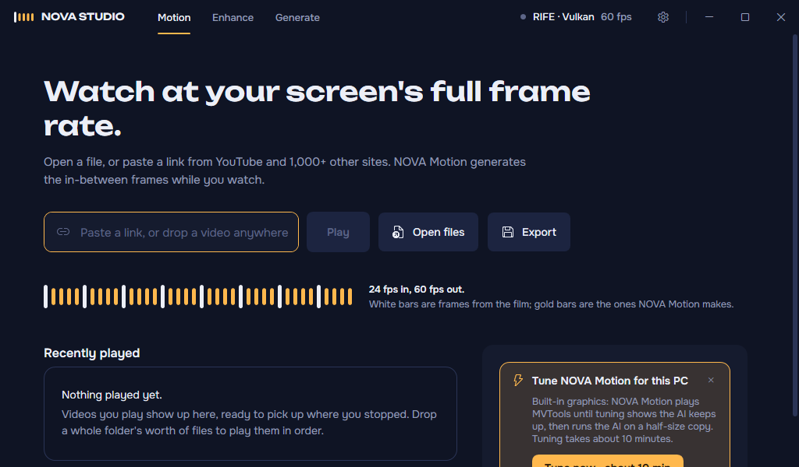
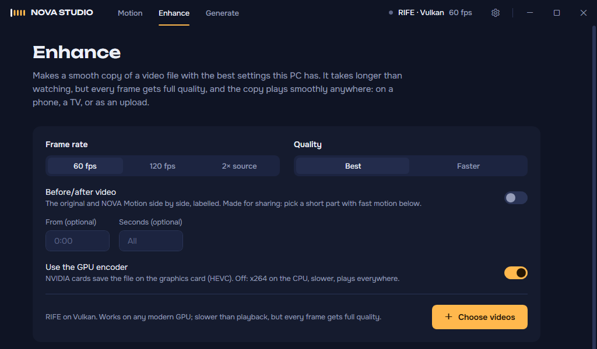

# NOVA Motion

**Watch at your screen's full frame rate.** Free, open-source AI motion smoothing for Windows, by Novabit. NOVA Motion generates the frames in between with AI, live, on your own graphics card, so 24 and 25 fps video plays smoothly instead of stepping. It runs even on a GTX 1650 laptop.

**[Download for Windows](https://github.com/owaiskamal/nova-motion/releases/latest)** · [Website](https://owaiskamal.github.io/nova-motion/) · [How it works](docs/ENGINEERING.md) · [Report a problem](https://github.com/owaiskamal/nova-motion/issues)

<!-- Demo: a 60 fps before/after clip goes here. Upload the MP4 by dragging it into this file in GitHub's web editor; GitHub inserts a link it plays inline. Credit under it: Footage: Tears of Steel (CC BY 3.0) Blender Foundation, mango.blender.org -->

## What it does

- **Real AI frames, live.** RIFE, an open AI model, makes the in-between frames while you watch. The frames from the video itself are never touched.
- **Fits your graphics card.** A one-time tuning run measures each model on your PC and the engine uses the best one that keeps up. On cards like a GTX 1650 the AI works on a half-size copy and only its frames are scaled up.
- **YouTube and 1,000+ sites.** Paste a link, or send the video you're watching from Chrome or Edge with the browser extension. It picks up where you stopped.
- **Steady, never stuck.** If frames start dropping it switches to a lighter setting on its own instead of stuttering; **Play without smoothing** is always one click away.
- **Enhance.** Save a smooth copy of any video that plays anywhere, or a labelled before/after clip to share.
- **Free and open.** GPL-3.0. No account, no watermark, no upload: everything runs on your PC.

## What runs on your PC

| Graphics | How NOVA Motion runs |
| --- | --- |
| NVIDIA RTX | RIFE on TensorRT, the fastest path, at your screen's refresh rate |
| NVIDIA GTX 16 (e.g. GTX 1650) | RIFE on TensorRT with the AI at half size, at 60 fps or an even rate for your screen |
| Other NVIDIA, AMD, Intel | RIFE on Vulkan when tuning shows it keeps up, MVTools otherwise. Supported, tested less so far |

Windows 10 or 11. TensorRT needs a one-time download of about 3 GB, offered during setup on cards that support it.

## Get started

**Installer:** download `NovaMotion-Setup` from the [latest release](https://github.com/owaiskamal/nova-motion/releases/latest), run it (no admin rights needed) and start NOVA Motion. NVIDIA RTX and GTX 16 users then run *Add NVIDIA TensorRT engine* from the Start menu once. Windows may show a SmartScreen warning because the installer isn't code-signed yet: choose *More info*, then *Run anyway*.

**From source:** run **`build.cmd`**. It sets everything up and says what it's doing, and you can run it again any time to repair or update; finished steps are skipped:

1. the .NET 8 SDK (offers to install it with winget),
2. the player runtime: mpv, VapourSynth, RIFE on Vulkan with four models, MVTools, yt-dlp (about 150 MB),
3. on NVIDIA RTX and GTX 16 cards, NVIDIA TensorRT through [vs-mlrt](https://github.com/AmusementClub/vs-mlrt) with RIFE 4.6, 4.22 Lite, 4.25 Lite and 4.26 (asks first),
4. the tests, then the app in `dist\`,
5. tuning for your PC, redone when it's outdated or the graphics changed,
6. Start menu and desktop shortcuts, and a summary of what's ready.

Options: `build.cmd -Yes` answers every question with yes; `-NoTensorRT`, `-NoTune` and `-NoShortcuts` skip those steps; `-CheckOnly` only reports what's set up.

**Browser extension (optional):** load `extension\` in Chrome or Edge (`chrome://extensions`, Developer mode, Load unpacked). Alt+Shift+F on any video page sends it to NOVA Motion at the same moment.

## Using it

- **Home:** paste a link or drop files. Recently played videos resume a few seconds before where you stopped, and opening an episode queues the rest of its folder.
- **On the video:** controls that hide while you watch, a seek bar with buffered range, chapters and hover time, double-click for full screen, scroll for volume.
- **Motion panel** (Tab): the frame rate on screen, dropped frames, the model in use and the size the AI runs at, the cadence strip (white bars are frames from the video, amber ones are generated), and every smoothing choice: engine, frame rate, AI model (Auto or a fixed one) and AI size (Auto, Full, 75 %, Half).
- **Before/after** (Ctrl+D): side by side or a split screen, labelled, to see what the engine adds.
- **Enhance:** a smooth copy of any file at 60 fps, 120 fps or 2× with the best model installed. Files queue up and show time left. Turn on **Before/after video** and give a start time and length to export a short labelled clip to share.
- **Subtitles, audio, speed and online quality** in one panel; drop a subtitle file on the video to load it.

## Keyboard

| Key | Action |
| --- | --- |
| Space / K | Play or pause |
| ← / → · Shift for 30 s | Back or forward 5 s |
| ↑ / ↓ · M | Volume · mute |
| F · Esc | Full screen · leave it |
| 0 – 9 | Jump to 0 % – 90 % |
| N / P | Next or previous in the queue |
| Tab | Motion panel |
| Ctrl+S | Smoothing on/off |
| Ctrl+E / Ctrl+T | Next engine / next frame-rate target |
| Ctrl+D | Before/after split screen |
| Ctrl+R | RTX Video Super Resolution |

The full list is in Settings → Keyboard shortcuts.

## When something isn't smooth

- Run **`tune.cmd`** after a driver update or a new graphics card, so the engine knows what your PC really keeps up with. Setup and the app also offer it.
- **`benchmark.cmd`** measures every engine on your PC (results in `runtime\benchmark.log`). Sharing the result in an issue helps others with the same card.
- **`collect-logs.cmd`** puts the player and engine logs, settings, tuning results and graphics info into `nova-motion-logs.zip` on your Desktop, to attach to an [issue](https://github.com/owaiskamal/nova-motion/issues).

## Tested on real PCs

Real playback, 1080p video, with the setting the engine picked on its own:

| PC | Video | Result |
| --- | --- | --- |
| RTX 4070 desktop, 60 Hz screen | 24 fps film to 60 | Smooth, RIFE 4.6 on TensorRT at full size |
| GTX 1650 laptop, 144 Hz screen | 24 fps film to 72 | Smooth, RIFE 4.6 on TensorRT with the AI at half size |
| GTX 1650 laptop, 144 Hz screen | 25 fps video | Plays at 50: 75 needs about 50 AI frames a second, more than this card makes |

Frames-per-second benchmarks are being measured again. Earlier figures came from a still test clip, which the engine processes faster than real video because it skips repeated frames, so they overstated speed; tuning and `benchmark.cmd` now use moving test frames. Measure your own PC with `benchmark.cmd`, and share the result in an issue to help others with the same card.

How the engine gets there, and the problems it took to make AI frames real-time on ordinary PCs, is in [docs/ENGINEERING.md](docs/ENGINEERING.md).

## NOVA Studio

NOVA Motion is the first module of **NOVA Studio**, a set of AI video tools that run on your own graphics card. In the app, the title bar has three tabs:

- **Motion:** real-time smoothing for files and online video. Available.
- **Enhance:** smooth copies of files; AI upscaling next. Available.
- **Generate:** images and short clips from open models (Flux, SDXL, Wan 2.2), handed straight to Enhance. In development; the page already checks what your PC can run.

The plan is in [docs/NOVA-STUDIO.md](docs/NOVA-STUDIO.md). The code, settings folder, `novamotion://` links and the installer's ID keep the NOVA Motion name, so installs update in place.

## Roadmap

| Milestone | Scope |
| --- | --- |
| M1 Foundations | ✅ CI with Windows UI screenshots · ✅ installer · ✅ pinned dependency versions |
| M2 Own player window | ✅ mpv inside the app, on-video controls, subtitles, queue, resume |
| M3 Engine manager | ✅ scene-cut and repeated-frame handling · ✅ per-size engine status and preparation · ✅ tuning, offered on first run · ✅ automatic model and AI-size choice with step-down · ✅ defaults for GTX and laptop graphics |
| M4 Online and launch | ✅ quality picker · ✅ daily yt-dlp updates · ✅ project site · extension in the stores |
| M5 Enhance & Export | ✅ offline smooth copies with the best model, queue, GPU encoding · heavier offline models (e.g. GIMM-VFI), upscaling |
| M6 NOVA Studio shell | ✅ one app with Motion, Enhance and Generate tabs · ✅ Generate hardware check |
| M7 Generate | managed ComfyUI engine, model manager, Flux.1 Schnell and SDXL images, Wan 2.2 video, one click to smooth and upscale |
| Later | light timeline (trim, join, titles), smoothing over any window, faster AMD/Intel paths, cloud GPU tier, mobile |

## Contributing

Bug reports with a `collect-logs.cmd` zip, benchmark results from your GPU, and pull requests are welcome. Building, tests and the project layout are in [docs/ENGINEERING.md](docs/ENGINEERING.md#development).

## License

NOVA Motion and NOVA Studio are free software under the [GNU GPL v3.0](LICENSE) (or later). It builds on mpv, VapourSynth, vs-mlrt, RIFE, MVTools and yt-dlp; see [THIRD_PARTY_NOTICES.md](THIRD_PARTY_NOTICES.md). NVIDIA TensorRT is downloaded by the setup script on your machine and is not part of this repository.

NOVA Motion is an independent project. It is not affiliated with NVIDIA, SVP (SmoothVideo Project) or the projects above, and contains no code from SVP.

© 2026 Novabit
